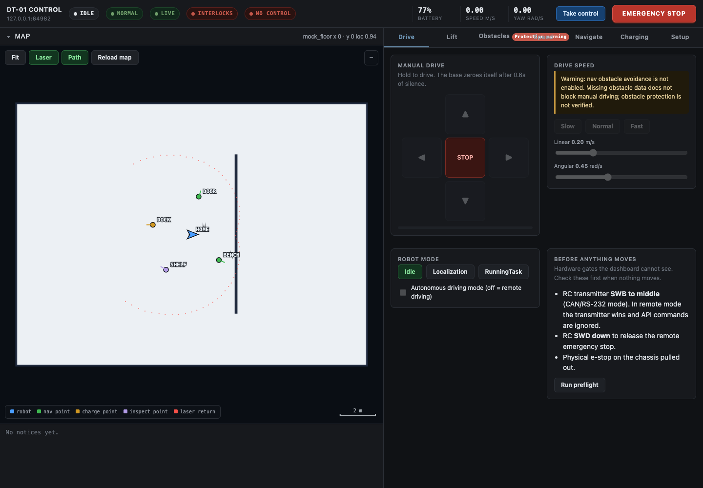

# DT-01 Pro kit

Everything you need to run a DT-01 Pro: drive the base, move the lift, watch
the cameras, and control the two arms from a VR headset.

It runs on the robot's own computer. You use it from a web browser.

| Page | What it is for | Address |
|---|---|---|
| **Control panel** | Start and stop the cameras and the arms | `http://<robot>:8090` |
| **Base + lift** | Drive the base, move the lift, send it to a saved point | `http://<robot>:8800` |
| **Cameras** | Live video from the robot's cameras | `http://<robot>:5175` |
| **VR page** | Open this in the headset to control the arms | `https://<robot>:8443` |

`<robot>` is the robot computer's address on your network. `setup.sh` prints it.



## What you need

- The robot, powered on, with its computer on your network (cable or Wi-Fi router).
- A laptop on the same network.
- A Meta Quest headset with both controllers, on the same network.
- A free [LiveKit](https://cloud.livekit.io) account. LiveKit carries the
  controller movements and the video between the headset and the robot.

## Set up (once, about 15 minutes)

**1. Get your LiveKit keys.** Sign in at <https://cloud.livekit.io>, create a
project, then open **Settings → Keys → Create key**. Keep the page open: you
need the **URL** (starts with `wss://`), the **API key** and the **API secret**.

**2. Put the kit on the robot computer** and run the setup script:

```bash
git clone <the link you were given> ~/dt01-pro-kit
cd ~/dt01-pro-kit
./setup.sh
```

It asks for a name for your robot, your three LiveKit values, and your
password (to install the services). At the end it prints the four addresses.

That is all. The four pages start by themselves every time the robot computer
boots.

## Drive the base and the lift

1. On the robot: pull the red e-stop **out**. On the remote control: switch
   **SWB to the middle** and **SWD down**.
2. Open the **Base + lift** page and press **Take control**.
3. Press **Run preflight**. Every line should be green.
4. Hold an arrow key (or an on-screen arrow) to drive. Let go and it stops.
5. The **Lift** tab raises and lowers the lift.

**Esc**, or the red **EMERGENCY STOP** button, stops everything at once.

> After the robot has been switched off and on, the base may accept commands
> and not move. Push the red e-stop in and pull it out again. Nothing on screen
> shows this.

## Control the arms in VR

Keep people clear of the arms before you start.

1. **Control panel → CAN & arms.** The first time only: give one adapter the role
   *left* and the other *right*, then press **Apply**.
2. **Control panel → Jobs.** Start **Cameras**, then start **Arm teleop**.
3. On the laptop, open the **Cameras** page so you can see what the arms see.
4. In the headset, open the browser and go to the **VR page**. The first time,
   the browser warns about the certificate: choose **Advanced → Proceed**.
5. Press **Connect**, then **Take control**, then **Enter VR**.

Then, with the controllers:

| Do this | What happens |
|---|---|
| Press **A** | Arms on. Press again to pause: the arms hold still. |
| Hold a **grip** button | That arm follows your hand. Let go and it holds still. |
| Squeeze a **trigger** | That arm's gripper closes. |
| Push a **thumbstick** up or down | Rotates that arm's last joint. |
| Press **X** | Both arms move to their home position. |

**To finish:** let go of the grips, press **A** to pause, then press **Stop**
on *Arm teleop* in the control panel and wait. It takes up to a minute to park
the arms.

> **Never switch the robot off, or force-stop Arm teleop, while it is
> stopping.** An arm interrupted there locks itself and stays locked until you
> unplug its power and plug it back in.

## Good to know

- **There are no passwords on these pages.** Anyone who can open them can move
  the robot. Keep the robot on a network you trust, and never open these ports
  to the internet. To use it from far away, use a private network such as
  [Tailscale](https://tailscale.com).
- **Your keys live in `.env`** in this folder. It is never uploaded anywhere.
  Do not share it.
- **Settings** (arm speeds, home positions, how far the arm moves per hand
  movement) are in the control panel under **configs.py**. Stop and start
  *Arm teleop* after you save.
- **Camera names and serial numbers** are in the control panel under **Jobs**,
  in the *Cameras* job. `.venv/bin/python -m arms.cameras --list` prints the
  serial of every camera that is plugged in.

## When something is wrong

See [docs/troubleshooting.md](docs/troubleshooting.md). The short list:

| What you see | Try this |
|---|---|
| Base page says "not connected" | Is the base on? Is its network cable in the robot computer? |
| Base accepts commands but does not move | Push the red e-stop in and pull it out. Check SWB and SWD. |
| Lift says "serial port not opened" | The lift's USB cable must be in the robot computer. Then restart: `sudo systemctl restart dt01-base` |
| A camera tile is black | Re-plug that camera's USB cable, then Stop and Start **Cameras**. |
| "Enter VR" does nothing | You must use `https://` and accept the certificate warning. |
| Arms do not move in VR | Did you press **Take control**, then **A**, then hold a **grip**? |
| An arm will not turn on | Control panel → CAN & arms → **Reclaim CAN control** for that arm. |

## More

- [docs/how-it-works.md](docs/how-it-works.md): what each part does and where the code is.
- [docs/troubleshooting.md](docs/troubleshooting.md): problems and fixes in more detail.
